<div align="center">


<br>

<a href="https://branding7dados-lab.github.io/sistema-b7/"></a>
<a href="https://github.com/branding7dados-lab/sistema-b7/releases/download/app-desktop/sistema-b7-instalador.exe"></a>
<a href="https://github.com/branding7dados-lab/sistema-b7/releases/latest/download/sistema-b7.apk"></a>


<br><br>

**O sistema de produção de conteúdo da Branding7.**<br>
Linha editorial, gravação, edição, design, aprovação do cliente, equipe e IA — tudo conversando entre si,<br>
no navegador, no computador e no celular.

<br>

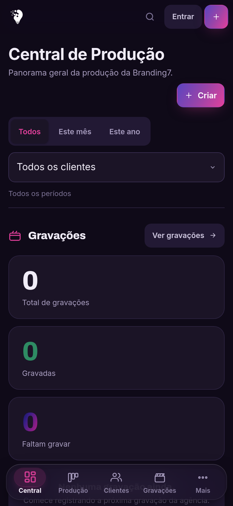
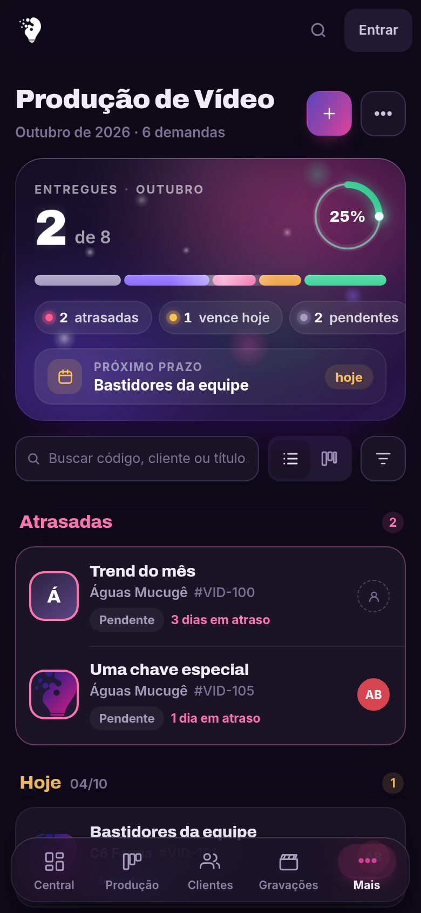
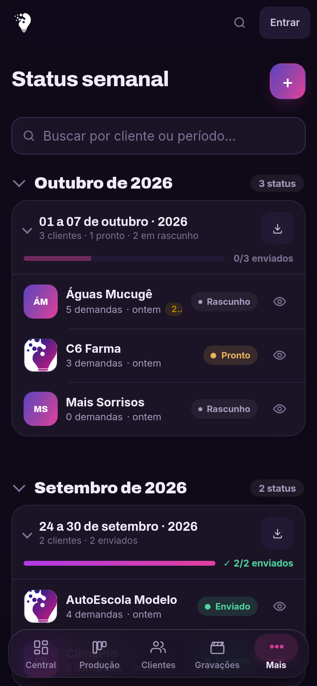
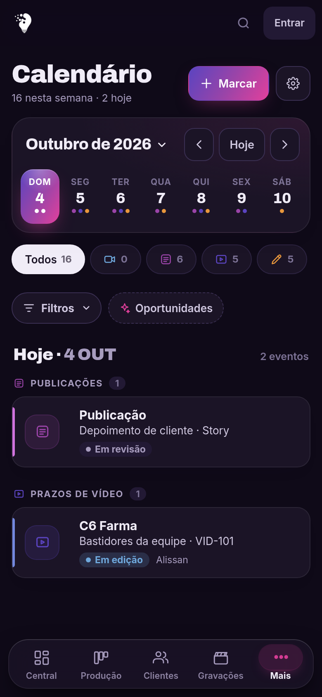

</div>

<br>

<table align="center">
<tr>
<td align="center"><h2>118</h2><sub>tabelas no banco</sub></td>
<td align="center"><h2>214</h2><sub>regras de acesso por linha</sub></td>
<td align="center"><h2>385</h2><sub>funções no servidor</sub></td>
<td align="center"><h2>107</h2><sub>módulos de tela</sub></td>
<td align="center"><h2>3</h2><sub>plataformas</sub></td>
<td align="center"><h2>400+</h2><sub>versões publicadas</sub></td>
</tr>
</table>

---

## ✦ O que é

O Sistema B7 acompanha o conteúdo da agência **do começo ao fim**. Cada cliente
tem uma **linha editorial** por mês; dela saem as **gravações**, as demandas de
**vídeo** e de **design**; o cliente **aprova** pelo portal dele; e o **status
semanal** fecha a conta dos sete dias.

<p align="center">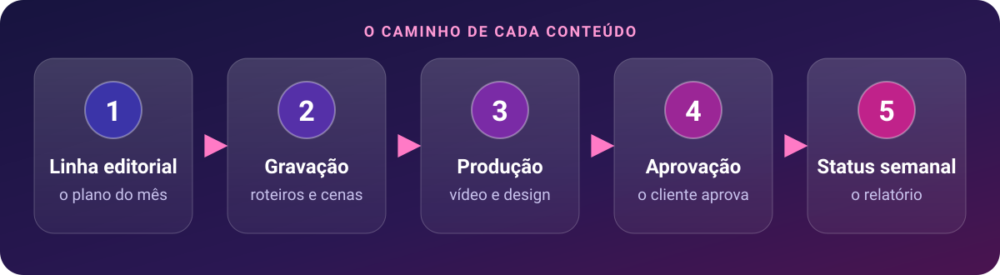</p>

Não é um gerenciador de tarefas genérico: **cada tela conhece o fluxo da
agência**. Uma demanda de vídeo sabe de qual conteúdo da linha ela nasceu, a
gravação sabe quais roteiros vai gravar, e o status semanal se atualiza sozinho
quando o conteúdo é publicado.

---

## ✦ Onde roda

<table>
<tr>
<td width="33%" valign="top" align="center">

### 🌐 Navegador
**PWA instalável**<br>
<sub>Abre em qualquer navegador e vira app na tela inicial. Funciona sem
internet para o que já foi visto e se atualiza sozinho.</sub>

</td>
<td width="33%" valign="top" align="center">

### 🖥️ Windows
**Programa (Electron)**<br>
<sub>Atualização automática, avisos do sistema, WhatsApp integrado com os
clientes reconhecidos e o atalho da Retrospectiva no Alt.</sub>

</td>
<td width="33%" valign="top" align="center">

### 📱 Android
**App (Capacitor)**<br>
<sub>Notificações no estilo WhatsApp (foto, Responder, Marcar como lida,
Silenciar), widget "Meu dia", gestos de arrastar entre abas e barra de vidro
líquido.</sub>

</td>
</tr>
</table>

---

## ✦ O que o sistema faz

<table>
<tr><td width="33%" valign="top">

#### 📋 Planejamento
- Linha editorial por cliente e mês, com pilares, funil e formatos
- Calendário de publicações e **datas comemorativas** que combinam com cada cliente
- Pacotes de produção: o que cada cliente contrata por mês
- Duplicar um mês levando só o que interessa

</td><td width="33%" valign="top">

#### 🎬 Produção
- **Gravações** com roteiros, cenas, referências e **teleprompter**
- **Vídeo** em lista ou kanban: prazo, responsável, versões, comentários com minuto, entrega
- **Design** por etapa: versões, revisão por parte, aprovação interna e do cliente
- **Legendas com IA**: corrige a fala sem trocar palavras
- Projetos avulsos fora do mês

</td><td width="33%" valign="top">

#### ✅ Cliente
- **Portal próprio**: vê só o que foi liberado, comenta e aprova
- Papéis de dono, gestor e equipe por empresa
- Pedidos pelo portal, recados e **pesquisa de satisfação**
- Status semanal exportável em PDF, um a um ou em lote

</td></tr>
<tr><td valign="top">

#### 👥 Equipe e gestão
- **Gestão → Equipe**: o que cada pessoa entregou, pontualidade, atrasos e o que precisa
- Saúde de cada cliente (0–100) com os motivos
- **Acompanhar ao vivo** a tela da equipe (e a do PC, nos computadores da empresa)
- Ausências, aniversários, repasse de trabalho e a **Retrospectiva** do mês

</td><td valign="top">

#### 💬 Comunicação
- **Chat** da equipe em tempo real, com foto, áudio, reações e respostas
- Avisos no aparelho mesmo com o sistema fechado, com **horário de silêncio**
- Prazos que avisam antes e escalam
- Resumo semanal por e-mail e mural de recados

</td><td valign="top">

#### 🤖 Inteligência artificial
- Assistente que conhece o cliente, a fila e a agência
- Roteiros, legendas, hashtags, revisão de marca e riscos
- Demandas criadas a partir de um pedido ou de um áudio de reunião
- **Groq** para o que é rápido, **Gemini** para áudio, imagem e português palavra por palavra

</td></tr>
</table>

<div align="center">
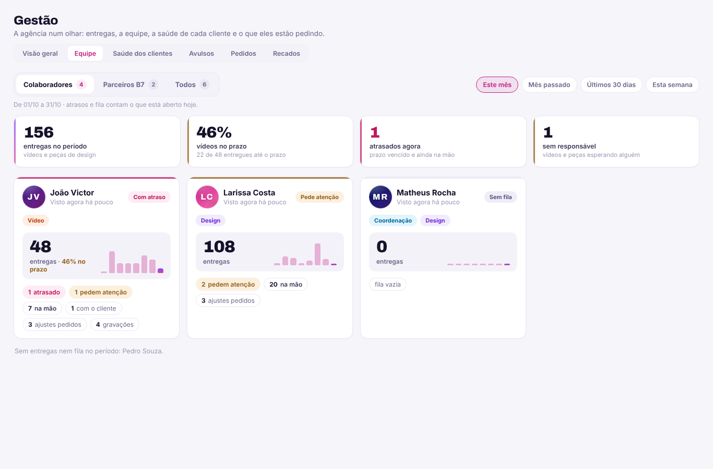
<br><sub><i>Gestão → Equipe: as entregas de cada pessoa, a pontualidade dos vídeos e o que pede atenção.</i></sub>
<br><br>
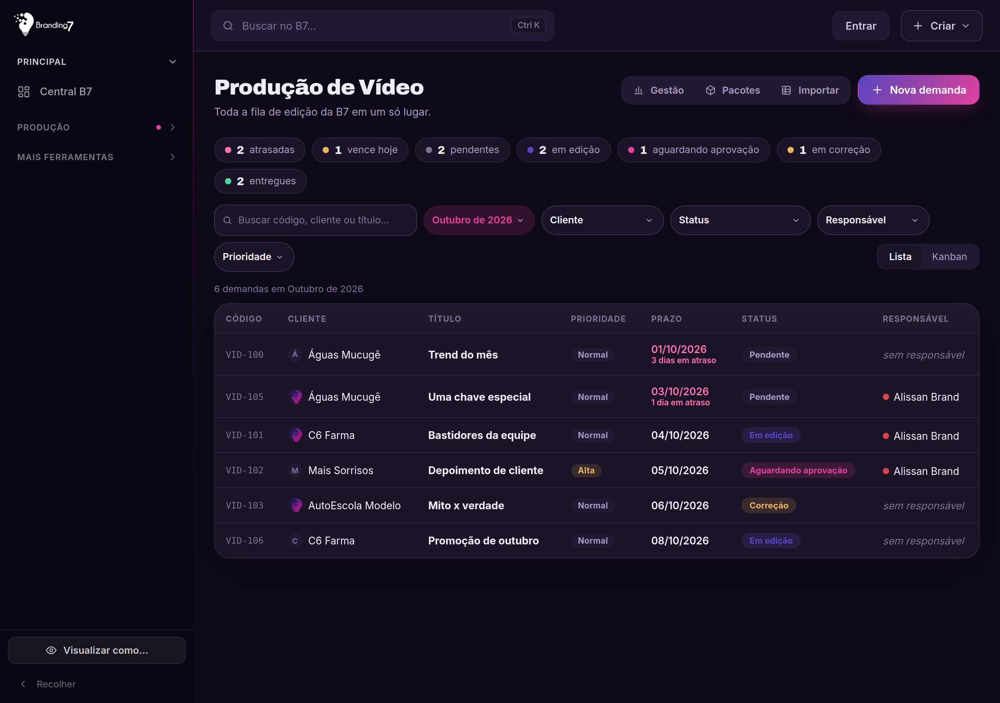
<br><sub><i>Produção de vídeo no computador: barra lateral, mais colunas e a gestão da equipe.</i></sub>
</div>

---

## ✦ As telas

<table>
<tr>
<td width="25%" align="center"><br><b>Central B7</b><br><sub>O panorama do dia: o que atrasou, o que vence, o que espera você.</sub></td>
<td width="25%" align="center"><br><b>Produção de vídeo</b><br><sub>A fila de edição com prazo, responsável e versões.</sub></td>
<td width="25%" align="center">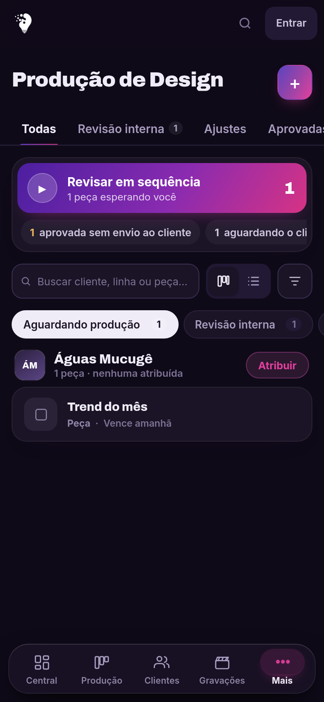<br><b>Design</b><br><sub>As artes por etapa, da produção à aprovação do cliente.</sub></td>
<td width="25%" align="center"><br><b>Status semanal</b><br><sub>O relatório de sete dias, pronto para enviar.</sub></td>
</tr>
<tr>
<td align="center">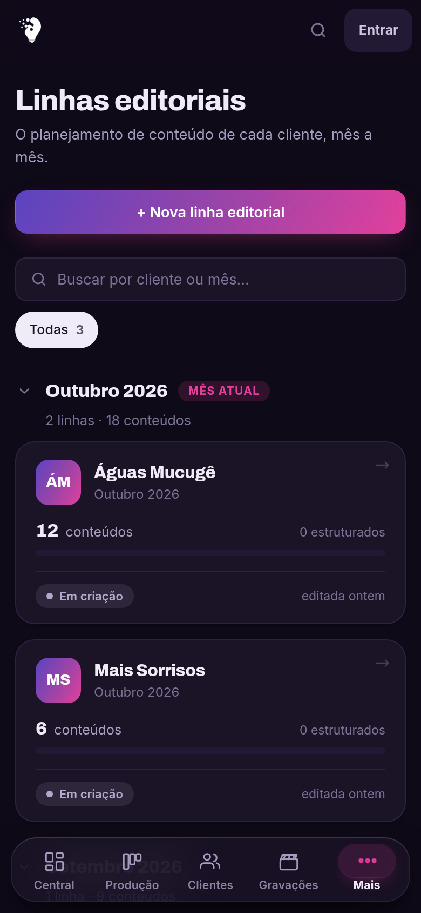<br><b>Linhas editoriais</b><br><sub>O planejamento de cada cliente, mês a mês.</sub></td>
<td align="center">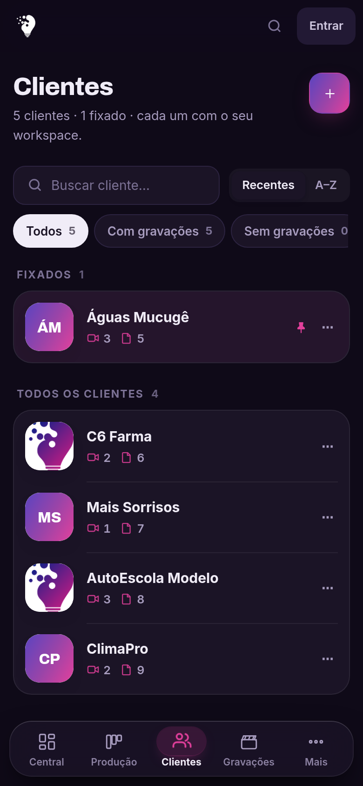<br><b>Clientes</b><br><sub>A carteira da agência, cada um com o espaço dele.</sub></td>
<td align="center">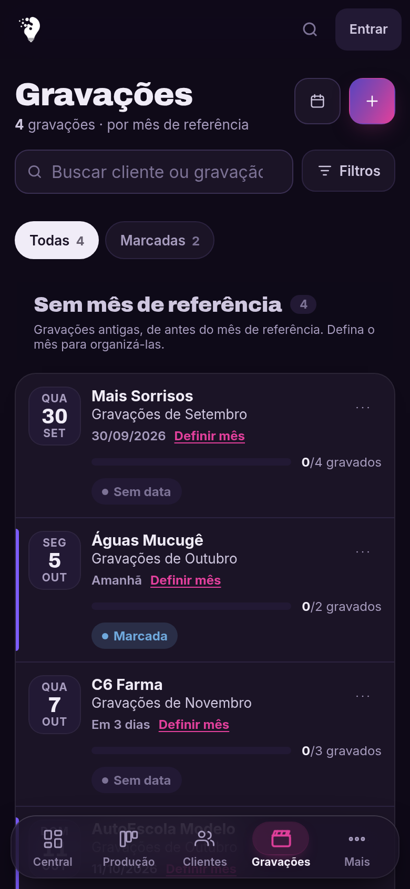<br><b>Gravações</b><br><sub>Sessões, roteiros e cenas, com teleprompter.</sub></td>
<td align="center"><br><b>Calendário</b><br><sub>A agenda da produção, ligada ao Google Agenda.</sub></td>
</tr>
</table>

---

## ✦ Quem usa e o que cada um vê

| Grupo | Papel | Enxerga |
|---|---|---|
| **Colaboradores** | Administrador | Tudo, incluindo contas, acessos, Gestão e configurações. |
| | Coordenador | A produção inteira da agência, sem a administração de contas. |
| | Designer | A fila de design e o contexto do briefing. |
| | Videomaker | A fila de edição, as gravações e o contexto do cliente. |
| **Parceiros B7** | Freelancers | O mesmo da função dada, marcados à parte para a gestão. |
| **Clientes** | Dono · Gestor · Equipe | Só o portal da empresa: o que foi liberado, para ver, pedir e aprovar. |

Cada função tem um **nível por módulo** (sem acesso · ver · editar · total) e
**ações** que ligam ou desligam sozinhas — por função ou só para uma pessoa.

> 🔒 As permissões valem **no banco**, não só na tela. Esconder um botão não
> protege nada: cada tabela tem regra por linha, o papel vem sempre do servidor e
> o próprio banco confere, sozinho, se alguém consegue mais do que devia.

---

## ✦ Como foi construído

<p align="center">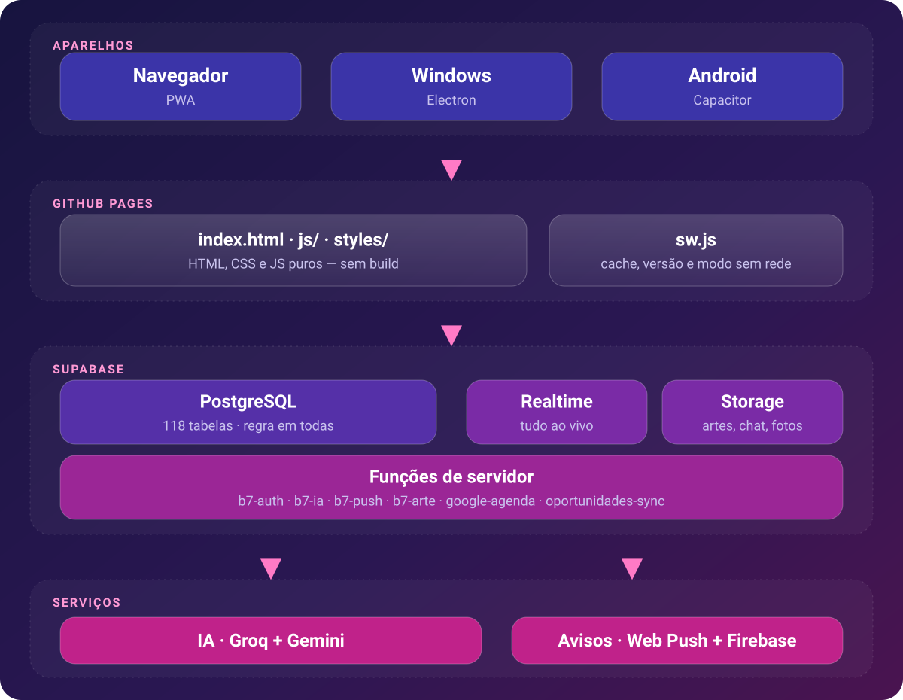</p>

**Sem framework e sem etapa de compilação.** O que está no repositório é
exatamente o que roda no navegador. Publicar é dar um merge: o GitHub Pages
serve em menos de um minuto, os apps do Windows e do Android são montados pelo
próprio GitHub, e cada aparelho recebe o aviso de versão nova.

| Camada | Tecnologia |
|---|---|
| Telas | HTML, CSS e JavaScript puros · View Transitions · vidro líquido com filtro SVG |
| Banco | Supabase (PostgreSQL) · RLS · Realtime · Storage |
| Servidor | Funções Deno no Supabase (login, 2 etapas, IA, avisos, agenda, artes) |
| IA | Groq (rápido) com Gemini de reserva e para áudio e imagem |
| Avisos | Web Push · Firebase Cloud Messaging · e-mail (Brevo) |
| Apps | Electron (Windows) · Capacitor (Android) |
| Testes | Playwright: teste de fumaça que abre todas as telas + testes por módulo |

<details>
<summary><b>Estrutura das pastas</b></summary>

```
sistema-b7/
├── index.html              a casca: topo, navegação e os contêineres das telas
├── sw.js                   service worker: cache, versão e funcionamento sem rede
├── manifest.json           o que faz virar app instalável
│
├── js/                     107 módulos — um por área
│   ├── app.js              rotas, arranque e trocas de tela
│   ├── auth.js             sessão, papéis e a VERSAO
│   ├── database.js         toda conversa com o Supabase
│   ├── permissoes.js       um lugar só decide o que cada papel alcança
│   ├── nav.js · vidro.js   menu, barra de baixo e o vidro líquido
│   ├── video.js · design.js · gravacao.js · linha.js · semana.js …
│   ├── gestao.js · colaboradores.js · usuarios.js
│   └── ia*.js              os apoios de IA
│
├── styles/                 um arquivo de estilo por área
├── assets/                 marca, ícones e fontes
├── app-android/            o app Android (Capacitor)
├── app-desktop/            o programa do Windows (Electron)
├── supabase/functions/     funções de servidor
├── supabase/sql/           a história do banco, em ordem (165 migrações)
├── docs/                   documentação; docs/relatorios/ tem um relatório por versão
└── testes/                 fumaça + testes por módulo
```

</details>

---

## ✦ Instalação

<details>
<summary><b>Passo a passo completo</b> — para montar uma cópia nova do zero</summary>

<br>

### 1. Criar o projeto no Supabase

Em <https://supabase.com>, crie uma conta e clique em **New project**. Dê um
nome, guarde a senha do banco e escolha a região **South America (São Paulo)**.
Espere uns dois minutos.

### 2. Criar as tabelas

No menu lateral, **SQL Editor → New query**. Abra o `supabase/sql/supabase_setup.sql` deste
projeto, cole tudo e clique em **Run**. Depois rode, na ordem, as migrações
`supabase/sql/migration_*.sql` que ainda não estiverem aplicadas.

Deve aparecer "Success". Se der erro, a mensagem costuma dizer exatamente o que
faltou.

### 3. Copiar as chaves

Em **Project Settings → API**, você precisa de dois valores:

| No Supabase aparece como | Para que serve |
|---|---|
| **Project URL** | o endereço do seu banco |
| **anon public** (ou **publishable key**) | a chave que o site usa para conversar com o banco |

> ⚠️ **Nunca copie a chave `service_role`.** Ela é secreta e daria acesso total a
> quem abrisse o site. A chave publicável é pública por natureza — essa pode.

### 4. Colocar no config.js

Abra `js/config.js` e substitua os dois `COLE_AQUI`:

```javascript
window.B7_CONFIG = {
  SUPABASE_URL: 'https://abcdefgh.supabase.co',
  SUPABASE_PUBLISHABLE_KEY: 'sb_publishable_...'
};
```

Se abrir o sistema sem isso, ele mostra uma tela explicando o que falta em vez
de quebrar.

### 5. Publicar no GitHub Pages

Suba os arquivos para um repositório e vá em **Settings → Pages**. Em
**Source**, escolha **Deploy from a branch**; em **Branch**, `main` e a pasta
`/ (root)`.

O arquivo `.nojekyll` parece inútil, mas não é: sem ele o GitHub ignora algumas
pastas. Não apague.

### 6. Criar o primeiro administrador

Siga o `docs/BOOTSTRAP.md`. O modo de bootstrap se desliga sozinho assim que existe
um administrador.

</details>

<details>
<summary><b>Rodar os testes</b></summary>

<br>

O teste de fumaça abre todas as telas num Chromium de verdade, com o banco
simulado, e falha se alguma quebrar ou abrir vazia.

```bash
cd testes
npm install
npm test
```

O GitHub roda sozinho a cada envio — veja `.github/workflows/testes.yml`.

</details>

---

## ✦ Publicar uma versão

Toda publicação sobe a versão, que tem três partes (detalhes em
[`VERSOES.md`](VERSOES.md)):

| Muda | Quando | Exemplo |
|---|---|---|
| o 1º número | mudança grande, que muda o jeito de usar | 3.4.2 → **4.0.0** |
| o 2º número | novidade que a equipe percebe | 3.4.2 → 3.**5**.0 |
| o 3º número | correção ou ajuste | 3.4.2 → 3.4.**3** |

O número fica em dois lugares, sempre iguais:

| Arquivo | O quê | Para quê |
|---|---|---|
| `js/auth.js` | `VERSAO = '3.0.0'` | aparece em Configurações, nas novidades e no app Android, e dispara o aviso de versão nova |
| `sw.js` | `CACHE = 'b7-v3.0.0'` | troca o cache do aparelho; sem isso o celular fica na versão velha |

Depois é só dar merge na `main`. O GitHub Pages publica em menos de um minuto e
cada aparelho recebe o aviso de atualização.

Cada pacote de mudança tem um relatório próprio (`docs/relatorios/RELATORIO_*.md`) explicando o
que mudou e por quê — são **mais de 400** até agora.

---

## ✦ Segurança

- **Login com verificação em 2 etapas** (e-mail ou app autenticador), entrar
  com Google e "esqueci minha senha" por e-mail de recuperação.
- **Níveis por módulo e ações por função**, com histórico de quem mudou o acesso
  de quem e uma conferência automática das regras do banco.
- **Proteção por linha em todas as tabelas.** Um cliente só alcança os dados
  dele, e só o que foi liberado para ele.
- **Nenhum segredo no repositório.** Só a chave publicável, que é pública por
  natureza. Chaves de IA, de notificação e de agenda ficam como variáveis de
  ambiente das funções de servidor.
- **Texto vindo do banco é sempre neutralizado** antes de ir para a tela, e
  links externos passam por uma peneira.

Encontrou algo? Abra uma issue privada ou fale direto com a equipe — não
descreva a falha num lugar público.

---

## ✦ Documentos

| Arquivo | Sobre |
|---|---|
| `docs/BOOTSTRAP.md` | criar o primeiro administrador |
| `docs/CENTRAL.md` | a Central de Conteúdo |
| `docs/SEMANA.md` | o Status Semanal |
| `docs/APROVACOES.md` | o fluxo de aprovação do cliente |
| `docs/IA.md` | como a IA é usada e os limites dela |
| `docs/BRAND.md` | identidade visual |
| `docs/CHECKLIST_TESTES.md` | roteiro de teste manual |
| `docs/relatorios/RELATORIO_HISTORICO_COMPLETO.md` | a história do sistema |

---

<div align="center">
<sub>Feito para a <b>Branding7</b> · Vitória da Conquista, BA</sub>
</div>
