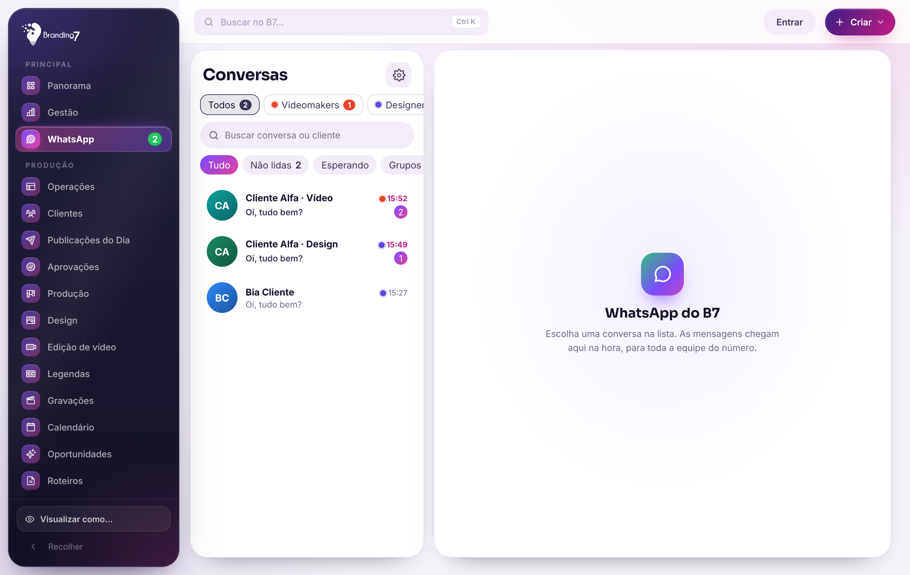
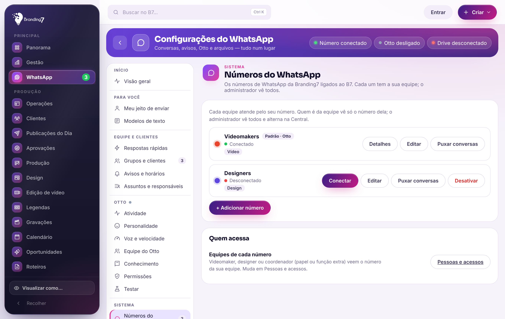

# Relatório 4.84.0: vários números de WhatsApp no B7 (23/11/2026)

## O que mudou
- **Cadastro de números** (`wa_numeros`). O número que já existia virou **Videomakers**: é o número padrão e o do Otto. Todo o histórico ficou nele.
- **Cada conversa e cada mensagem sabem por qual número passaram** (`numero_id`). O mesmo grupo de cliente pode estar no número dos vídeos e no do design sem um apagar o outro.
- **Quem vê o quê** (regra no banco):
  - o administrador vê todos os números;
  - videomaker, designer e coordenador (pelo papel ou por função extra) veem os números da sua equipe.
- **Central**:
  - com 2 ou mais números, aparece a barra "Todos · Videomakers · Designers…" com as não lidas;
  - em "Todos", cada conversa mostra a cor do número, e o cabeçalho mostra "via <número>";
  - a resposta sai **sempre** pelo número da conversa;
  - quem só tem um número vê a Central como antes.
- **Configurações do WhatsApp → Números do WhatsApp**: adicionar (nome, cor, equipes e QR Code), conectar, editar, puxar conversas e desativar. O padrão não pode ser desativado.
- **"Enviar no WhatsApp"**: começa no número da equipe de quem envia, e quem vê vários números pode trocar.
- **Otto e relógio**: continuam **só no número dos Videomakers**, como decidido.

## Ordem de publicação (importante)
1. **Actions → sql → Run workflow** com `supabase/sql/zzz383_wa_varios_numeros.sql`.
2. **Logo em seguida, merge na main.** As Edge Functions e o site publicam sozinhos. Entre o passo 1 e o 2, o botão antigo "Puxar conversas" não funciona; o resto segue normal.
3. O número padrão começa cadastrado como `b7-piloto`. Se o segredo `EVOLUTION_INSTANCE` (Supabase → Edge Functions → Secrets) tiver outro nome, **o B7 corrige sozinho** na primeira mensagem que chegar e deixa um aviso no log. Para corrigir na mão, rode no SQL Editor:
   `update public.wa_numeros set instancia = '<valor do segredo>' where padrao;`
4. Configurações do WhatsApp → Números do WhatsApp → **+ Adicionar número** → leia o QR Code com o celular do número novo.

## Segurança e falhas (revisão final)
- Quando a leitura do cadastro de números falha por um instante, o webhook responde 503 e o Evolution manda de novo. A mensagem nunca cai no número errado.
- Número criado há poucos segundos: o webhook relê o cadastro antes de ignorar a mensagem.
- As ações que passam pelo Otto (responder dúvida, sugerir resposta, amostra de voz) exigem ver o número dos Videomakers.
- Ninguém envia por um número desativado, nem o administrador.
- Abrir foto ou vídeo de um grupo que está em dois números funciona pelo link do Drive.

## Limites desta versão
- No número dos Videomakers, tudo funciona como antes. Nos números novos, **Sugerir resposta** (✨) avisa que ainda só funciona no número dos Videomakers, e a **transcrição de áudio** não fica guardada, porque as duas passam pelo Otto.
- Os avisos de "cliente esperando" (push) continuam saindo só do número dos Videomakers, também porque dependem do Otto.

## Testes
- `bash testes/sql/wa-numeros.sh`: migração aplicada 2× num Postgres 16 local. Testa a chave composta, o acesso por equipe, o número desativado e a junção de @lid dentro do mesmo número.
- `testes/wa-numeros-servidor.test.mjs`, `wa-otto-padrao.test.mjs` e `wa-numeros-tela.test.mjs`: peças puras do servidor e da tela, e a trava do Otto.
- `testes/wa-central.test.mjs` (Chromium): barra, filtro, envio pelo número certo, Configurações → Números e "Enviar no WhatsApp".
