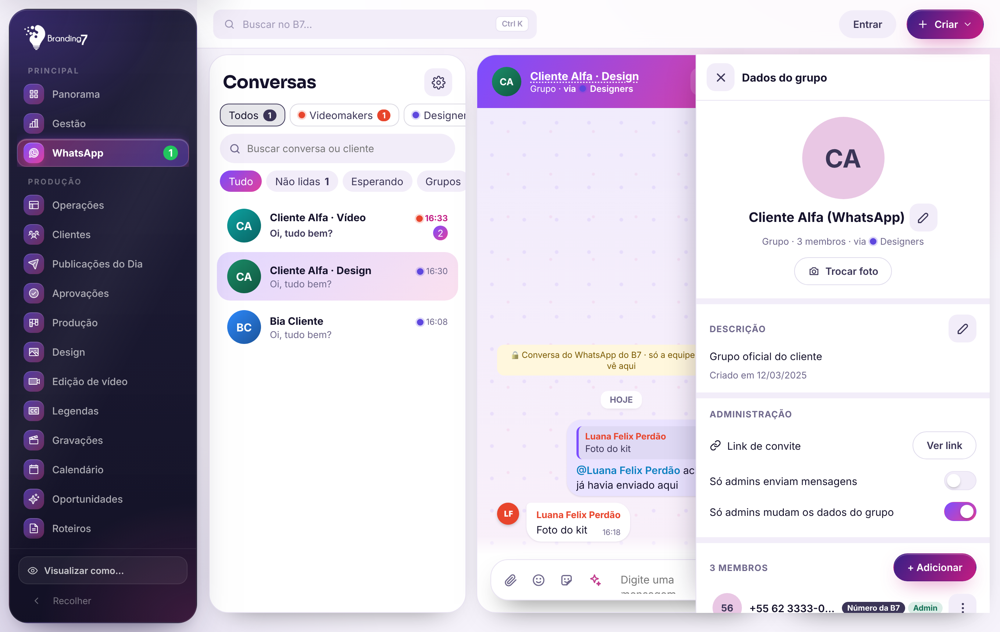
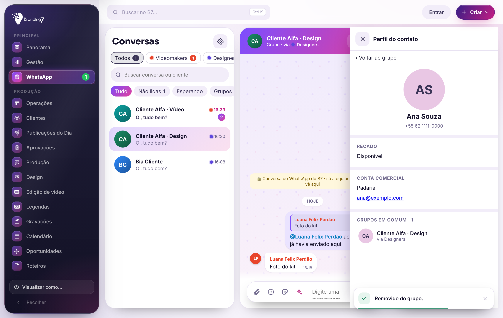
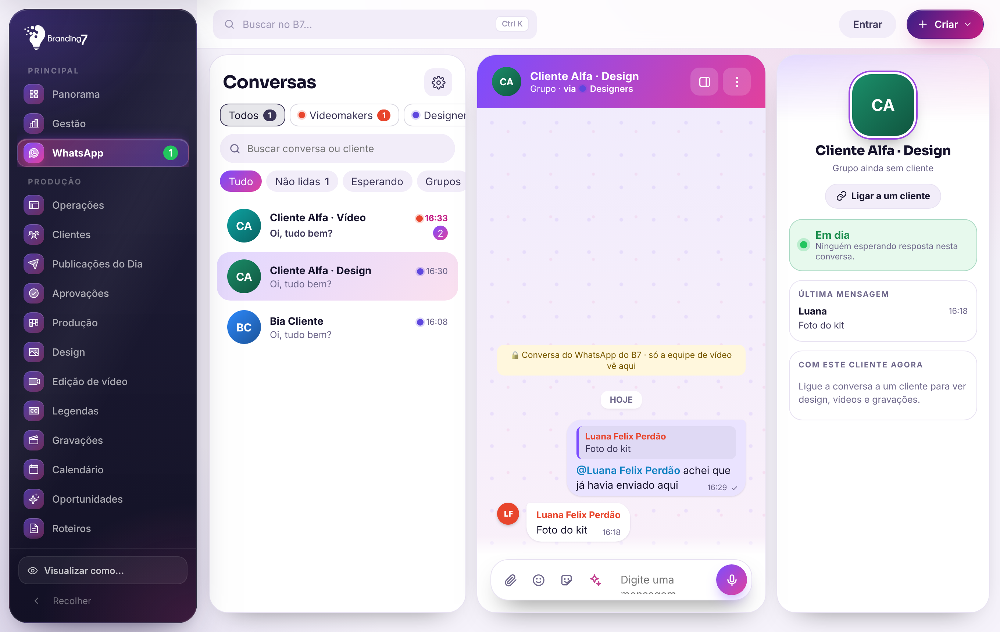

# Relatório 4.85.0: dados do grupo e perfil do contato (23/11/2026)

## O que mudou
- **Dados do grupo:** na Central, tocar na foto ou no nome no topo da conversa abre um painel com:
  - foto, nome, descrição e data de criação;
  - os membros, com os selos **Admin**, **Equipe B7** e **Número da B7**.
- **Perfil do contato:** foto, nome, número, recado, conta comercial (descrição, e-mail, site), cliente ligado e **grupos em comum**. Abre pelo topo de uma conversa individual, pelo nome de quem escreveu no grupo ou por uma menção @.
- **Só o administrador do B7 mexe no grupo**:
  - adicionar e remover membros, tornar ou tirar admin;
  - trocar o nome, a descrição e a foto no WhatsApp;
  - ver, copiar e trocar o link de convite;
  - escolher "só admins enviam" e "só admins mudam os dados".

  Remover, trocar o link e mudar as regras pedem confirmação. Se o número da B7 não for admin do grupo, os botões ficam desligados com o aviso. A equipe vê tudo, mas sem os botões, e o servidor recusa mesmo assim.
- **Menções como no WhatsApp:** "@221633885266163" vira **@Nome** em destaque, e clicar abre o perfil. A citação, o nome de quem escreveu, a foto e a "Última mensagem" mostram o nome da pessoa em vez do código.

## Como os dados se mantêm
- O painel abre na hora com o que já está guardado (tabela `wa_grupo_membros`) e se atualiza com o WhatsApp.
- A lista é atualizada:
  - a cada abertura do painel;
  - quando o WhatsApp avisa que alguém entrou ou saiu;
  - na atualização de contatos (a cada 6 h, quando um administrador abre a Central). É essa atualização que preenche os "grupos em comum" de todos os grupos.

## Depois do merge
- A `zzz385` vai para o banco sozinha.
- **Um passo manual:** abra uma vez Configurações do WhatsApp → Números do WhatsApp. Isso religa o webhook com o aviso novo de entradas e saídas.

## Testes
- `bash testes/sql/wa-numeros.sh`: grupos em comum só nos números que a pessoa vê, e a busca por telefone guardado do `@lid`.
- `testes/wa-grupo.test.mjs`: membros vindos como `@lid`, saber se a B7 é admin, avisos do webhook, resultado por pessoa com o motivo.
- `testes/wa-central.test.mjs` (Chromium):
  - menção e citação;
  - dados do grupo e selos;
  - remover com confirmação, pelo número certo;
  - perfil com grupos em comum;
  - a visão do designer, sem os botões;
  - resposta atrasada que não reaparece em outra conversa.
